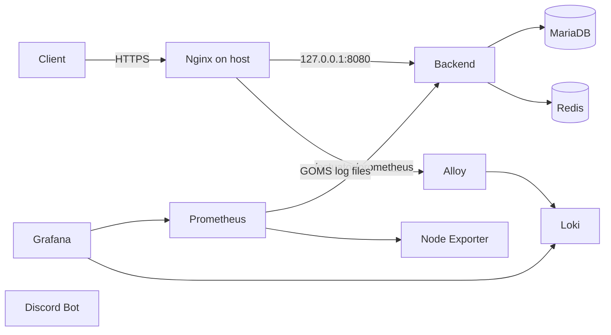

# GOMS DevOps

GOMS 운영 서버에서 2026-11-10에 실제 사용 중임을 확인한 호스트 설정, 모니터링 설정, 배포 스크립트와 운영 현황을 보존한다. 이 저장소를 작성하면서 서버 설정이나 배포 방식을 변경하지 않았다. 저장소 파일은 현재 서버에 자동 적용되지 않는다.

## Infrastructure Architecture

실선은 Nginx 설정, Docker 네트워크, Prometheus·Alloy 설정에서 확인한 관계다. Bot은 별도 네트워크에서 실행되며 Backend API 접속 경로는 환경변수 값을 조사하지 않아 연결을 표시하지 않았다.

## Services

운영 서버의 Docker Compose 프로젝트는 Backend 3개(앱, MariaDB, Redis), Bot 1개, Monitoring 5개(Prometheus, Grafana, Loki, Alloy, Node Exporter) 컨테이너로 구성된다. Nginx는 호스트 서비스다. [인프라 현황](docs/infrastructure.md)에 네트워크, 볼륨, 서버 경로를 기록했다.

## Technology Stack

Ubuntu 22.04 · Docker Compose · Nginx · MariaDB 11.4 · Redis 7.4 · Prometheus · Grafana · Loki · Alloy · Node Exporter

## Repository Structure

- scripts/: 현재 GitHub Actions가 서버에서 호출하는 배포 스크립트 원본
- nginx/: 현재 호스트의 GOMS 사이트와 관측 로그 포맷
- monitoring/: 현재 Monitoring Compose와 bind mount 설정
- docs/: 운영 구성, 배포, 모니터링, 장애 대응의 확인 결과

서버 파일과 저장소 파일의 대응 관계는 [인프라 현황](docs/infrastructure.md)에 있다. 서버의 파일을 이 저장소 경로에서 바로 실행하도록 구성한 것은 아니다.

## Deployment

Backend와 Bot의 각 main push workflow가 서버의 별도 스크립트를 호출한다. 이 저장소로 push해도 운영 배포는 시작되지 않는다. 현재 실행 흐름과 미확인 검증·복구 절차는 [배포 문서](docs/deployment.md)에 기록했다.

## Monitoring

Prometheus, Loki, Alloy와 Grafana datasource는 파일로 구성된다. Grafana Dashboard·Alert의 실제 목록과 관리 방식은 확인되지 않았다. [모니터링 문서](docs/monitoring.md)를 참조한다.

## Operations & Documentation

[장애 대응 문서](docs/troubleshooting.md)는 읽기 전용 확인 명령과 확인되지 않은 백업·복구 조건을 기록한다. 이 저장소에는 Secret, 인증서, DB dump, Docker volume, 로그, Bot 자동화 상태를 보존하지 않는다. 기존 .env의 값과 재주입 절차는 확인되지 않아 이 저장소만으로 재배포·재구축할 수 있다고 단정하지 않는다.

## Related Repositories

- [GOMS-Backend-V3](https://github.com/team-haribo/GOMS-Backend-V3): 앱 코드, Dockerfile, Compose, 배포 workflow
- [GOMS-Bot-V1](https://github.com/team-haribo/GOMS-Bot-V1): Bot 코드와 배포 workflow. 현재 서버의 Bot Dockerfile·Compose는 해당 체크아웃에서 Git 미추적이며, 이 저장소에 중복 수록하지 않았다.
